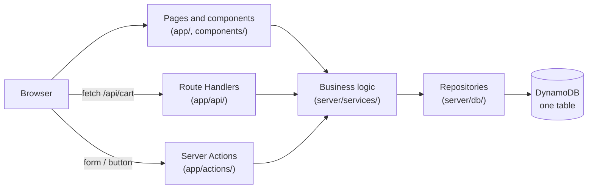

# Marketline

Marketline is a full-stack e-commerce web app: a general online store in the style of Amazon or eBay, with categories, product search and filters, a shopping cart and a wishlist. It is built with Next.js, TypeScript and AWS DynamoDB.

Built as the second Software Engineer Intern project for Tynoc Tech.


> **Live demo:** a hosted demo was optional for this assignment, so there isn't one. The app runs locally in a few minutes with a free local copy of DynamoDB; see [Run locally](#run-locally).

## Contents

- [Features](#features)
- [Screenshots](#screenshots)
- [Tech stack](#tech-stack)
- [Architecture](#architecture)
- [Data model (DynamoDB)](#data-model-dynamodb)
- [Run locally](#run-locally)
- [Environment variables](#environment-variables)
- [Scripts](#scripts)
- [Testing](#testing)
- [Project structure](#project-structure)
- [Security](#security)
- [Design decisions and limitations](#design-decisions-and-limitations)

## Features

### Storefront
- Homepage with categories, **today's deals** (biggest discount first), featured products and new arrivals
- 10 categories and 60 sample products, each with brand, price, sale price, rating, stock and tags
- **Category pages** and an **All products** page
- **Product pages** with price and saving, stock status, details, related searches and **related products** (same category, sharing the most tags)
- **Search** from the header: every word must match, and matches in the name rank highest ("Best match")
- **Filters** on every listing: category, brand (with counts), price range, minimum rating, in stock only, plus six sort orders. Filters live in the URL, so results can be bookmarked and shared, and active filters show as removable chips.

### Accounts
- Sign up, log in and log out; the header greets you by name
- Protected pages (account, wishlist) send you to the login page and back afterwards

### Cart
- Works for **guests and logged-in users**
- Add to cart with a quantity, change quantities, remove items; line totals, item count and **subtotal**
- At most 10 of one product, and never more than the stock
- When a guest logs in or signs up, their cart is **merged into their account's cart**
- Cart count badge in the header
- Built on a small **REST API** (Route Handlers): see [docs/api.md](docs/api.md)

### Wishlist
- Save and unsave products with one click (for logged-in users)
- Wishlist page with "Add to cart" and "Remove" for each product
- **Duplicates are impossible**: DynamoDB itself refuses a second copy
- Built with **Server Actions**, so the project shows both ways of changing data (API for the cart, Server Actions for the wishlist)

### Experience
- Responsive from phone to desktop
- **Loading** skeletons while data loads, **empty** states (cart, wishlist, no search results), a styled **404** page and an **error** page with "Try again"
- If the database is unreachable, the header keeps working and the page shows the error page instead of crashing
- Input validation on the server for every form and API request, with clear messages

## Screenshots

| Search results | Category with filters |
| --- | --- |
|  |  |

| Product page | Cart |
| --- | --- |
|  |  |

| Wishlist | Today's deals |
| --- | --- |
|  |  |

| Login | 404 page | Phone |
| --- | --- | --- |
|  |  |  |

## Tech stack

| Layer      | Choice                                                                 |
| ---------- | ---------------------------------------------------------------------- |
| Frontend   | Next.js 16 (App Router, Cache Components), React 19, TypeScript        |
| UI         | Tailwind CSS 4, Lucide icons                                           |
| Backend    | Next.js Route Handlers (cart API) and Server Actions (accounts, wishlist) |
| Database   | AWS DynamoDB via the AWS SDK v3 (DynamoDB Local for development)       |
| Validation | zod, shared by forms, API routes, URLs and seed data                   |
| Auth       | Email and password (bcrypt), sessions stored in DynamoDB               |
| Tests      | Vitest: business-logic tests                                           |
| CI         | GitHub Actions: lint, type-check, test and build on every push         |

## Architecture



Each layer only talks to the one below it:

- **Pages and components** (`app/`, `components/`) show data. Server Components load it on the server; small Client Components handle clicks.
- **Route Handlers** (`app/api/`) and **Server Actions** (`app/actions/`) receive changes from the browser, validate them with zod and call the business logic.
- **Business logic** (`server/services/`) holds the rules: search scoring, filters, sorting, deals, related products, cart limits and totals, merging carts, sessions. Most of it is pure functions, which is what the tests cover.
- **Repositories** (`server/db/`) are the only code that talks to DynamoDB. They build every key through `server/db/keys.ts` and turn stored items into plain types (`types/`), so the rest of the app never sees `PK`, `SK` or DynamoDB commands.

Pages use Next.js **Partial Prerendering**: the layout and static parts are prerendered, and anything that reads the database or cookies streams in inside `<Suspense>` with a loading skeleton. Data is read when a visitor asks for a page (`connection()`), so prices and stock are always current and the build never needs a database.

## Data model (DynamoDB)

All data lives in **one DynamoDB table** (single-table design) with a partition key `PK`, a sort key `SK` and two global secondary indexes:

| Entity        | PK                    | SK                       | Index keys                                                     |
| ------------- | --------------------- | ------------------------ | -------------------------------------------------------------- |
| User          | `USER#<userId>`       | `PROFILE`                |                                                                |
| Email lock    | `EMAIL#<email>`       | `EMAIL`                  |                                                                |
| Session       | `SESSION#<tokenHash>` | `SESSION`                |                                                                |
| Category      | `CATEGORY#<slug>`     | `CATEGORY`               | GSI1: `CATEGORIES` / `<sortOrder>#<slug>`                      |
| Product       | `PRODUCT#<slug>`      | `PRODUCT`                | GSI1: `CATEGORY#<category>`; GSI2: `PRODUCTS` / `<createdAt>#<slug>` |
| Cart item     | `CART#<owner>`        | `ITEM#<productSlug>`     |                                                                |
| Wishlist item | `USER#<userId>`       | `WISHLIST#<productSlug>` |                                                                |

Every page needs at most a couple of `GetItem`, `Query` or `BatchGetItem` calls, never a table scan. The database itself enforces the key rules:

- **Unique emails:** a user and their email "lock" item are written in one transaction with `attribute_not_exists`.
- **No duplicate wishlist items:** the product is part of the key, and the write is conditional.
- **Cart limits:** quantities are added with an atomic `ADD` and a condition, so quick repeated clicks are all counted and can't exceed the limit.
- **Expiry:** guest carts and sessions get a `ttl` attribute, and DynamoDB's time to live removes them.

The full design, with all 22 access patterns and the create/read/update/delete operations for each entity, is in **[docs/data-model.md](docs/data-model.md)**. The cart API is documented in **[docs/api.md](docs/api.md)**.

## Run locally

### Prerequisites

- [Node.js](https://nodejs.org/) 20.9 or newer (24 LTS recommended; see `.nvmrc`)
- [Git](https://git-scm.com/)
- **DynamoDB Local**, a free copy of DynamoDB that runs on your computer. Use **one** of the two options below.

### 1. Get the code

```bash
git clone <this-repo-url>
cd marketline
npm install
cp .env.example .env   # Windows PowerShell: Copy-Item .env.example .env
```

The values in `.env.example` already point to DynamoDB Local on `http://localhost:8000`, so `.env` needs no changes.

### 2. Start DynamoDB Local

**Option A: with Java** (Windows, macOS or Linux)

1. Install Java 17 or newer, for example [Eclipse Temurin](https://adoptium.net/) (we used Java 21). On Windows: `winget install EclipseAdoptium.Temurin.21.JDK`. Check it with `java -version`.
2. Download DynamoDB Local (the **v2.x/v3.x** zip) from the [AWS download page](https://docs.aws.amazon.com/amazondynamodb/latest/developerguide/DynamoDBLocal.DownloadingAndRunning.html) and extract it to a folder of your choice, for example `C:\dynamodb-local`.
3. In a **separate terminal**, inside that folder, start it and leave it running:

   ```bash
   # macOS / Linux
   java -Djava.library.path=./DynamoDBLocal_lib -jar DynamoDBLocal.jar -sharedDb
   ```

   ```powershell
   # Windows PowerShell (the quotes are needed)
   java "-Djava.library.path=./DynamoDBLocal_lib" -jar DynamoDBLocal.jar -sharedDb
   ```

   It prints `Port: 8000`. `-sharedDb` keeps the data in a file (`shared-local-instance.db`) in that folder, so it survives restarts.

> **Windows tip:** if `java` isn't found even though it's installed, save this as `start-dynamodb.cmd` in the DynamoDB Local folder and double-click it. It finds Java by itself:
>
> ```bat
> @echo off
> cd /d "%~dp0"
> for /d %%D in ("C:\Program Files\Eclipse Adoptium\jdk-*") do set "JAVA=%%D\bin\java.exe"
> "%JAVA%" -Djava.library.path=./DynamoDBLocal_lib -jar DynamoDBLocal.jar -sharedDb
> pause
> ```

**Option B: with Docker**

```bash
docker run --rm -p 8000:8000 amazon/dynamodb-local
```

This keeps the data in memory only: after a restart, run step 3 again.

### 3. Create the table and add the sample products

```bash
npm run db:ping    # checks the connection
npm run db:setup   # creates the table, its two indexes and time to live
npm run db:seed    # adds 10 categories and 60 products
```

Expected output of `db:seed`:

```
Seed data is valid: 10 categories, 60 products.
Saved 10 categories.
Saved 60 products.
Check: the table now holds 10 categories and 60 products.
```

If something fails, the scripts print a plain-English hint, for example "Nothing is answering. Is DynamoDB Local running?".

### 4. Start the app

```bash
npm run dev
```

Open <http://localhost:3000>, create an account and try the store.

### Using real AWS DynamoDB instead

The code is the same; only `.env` changes:

1. In AWS IAM, create a user with an access key and a policy that only allows `dynamodb:*` on `arn:aws:dynamodb:<region>:*:table/marketline*`, plus `dynamodb:ListTables` (for `db:ping`).
2. In `.env`, set `DYNAMODB_REGION` (e.g. `eu-west-1`), set the two access-key variables, and leave `DYNAMODB_ENDPOINT` empty.
3. Run `npm run db:setup` and `npm run db:seed` as above. (`db:reset` refuses to run against AWS, as a safety net.)

To deploy (for example on Vercel), add the same environment variables to the hosting project.

## Environment variables

`.env` is git-ignored and never committed. `.env.example` lists every variable with values for DynamoDB Local.

| Variable                     | Purpose                                                              |
| ---------------------------- | -------------------------------------------------------------------- |
| `DYNAMODB_REGION`            | AWS region, e.g. `eu-west-1`                                         |
| `DYNAMODB_ENDPOINT`          | `http://localhost:8000` for DynamoDB Local; empty for real AWS       |
| `DYNAMODB_TABLE_NAME`        | The table's name, `marketline`                                       |
| `DYNAMODB_ACCESS_KEY_ID`     | Any letters for DynamoDB Local; an IAM access key for AWS            |
| `DYNAMODB_SECRET_ACCESS_KEY` | Any letters for DynamoDB Local; the IAM secret key for AWS           |

The variables are checked with zod when the database is first used (`server/config/env.ts`), so a missing or mistyped value gives a clear error. They're named `DYNAMODB_*` rather than `AWS_*` because hosts such as Vercel reserve the `AWS_*` names.

## Scripts

| Command             | What it does                                             |
| ------------------- | -------------------------------------------------------- |
| `npm run dev`       | Start the development server                             |
| `npm run build`     | Create a production build                                |
| `npm start`         | Run the production build                                 |
| `npm run lint`      | Lint with ESLint                                         |
| `npm run typecheck` | Generate route types and run `tsc`                       |
| `npm test`          | Run the automated tests (Vitest)                         |
| `npm run db:ping`   | Check the connection to DynamoDB                         |
| `npm run db:setup`  | Create the table and its indexes (skips if it exists)    |
| `npm run db:seed`   | Add the sample categories and products (safe to re-run)  |
| `npm run db:reset`  | Delete and recreate the table (DynamoDB Local only)      |

## Testing

```bash
npm test
```

46 automated tests (Vitest) cover the business logic. They need neither a database nor a browser and run in about a second:

| File                     | What it checks                                                                       |
| ------------------------ | ------------------------------------------------------------------------------------ |
| `tests/catalog.test.ts`  | Sorting, search scoring, every filter, brand counts, deals, featured, new arrivals, related products |
| `tests/cart.test.ts`     | Quantity limits, line totals and subtotal, missing products, merging guest carts, request validation |
| `tests/filters.test.ts`  | Reading filters from URLs (defaults, invalid values, euro to cents) and building URLs |
| `tests/utils.test.ts`    | Euro formatting, discounts, safe redirects, sign-up rules                            |

GitHub Actions runs lint, type-check, tests and a production build on every push.

Each feature was also tested by hand in the browser (desktop and phone width) against DynamoDB Local, including logging in with a guest cart, saving the same product from two tabs, and switching the database off to check the error page.

## Project structure

```
app/                        # Pages, layouts and routes (Next.js App Router)
  page.tsx                  # Homepage
  products/                 # All products + search (page.tsx), product page ([slug]/)
  categories/[slug]/        # Category pages
  cart/, wishlist/          # Cart and wishlist pages
  login/, signup/, account/ # Account pages
  api/cart/                 # Cart REST API (Route Handlers)
  actions/                  # Server Actions: accounts, wishlist
  not-found.tsx, error.tsx  # 404 and error pages
components/                 # Reusable UI: product card and grid, filters, header, ...
lib/
  validation/               # zod rules: catalog, filters, cart, accounts
  utils/                    # Money formatting, filter URLs, safe redirects
  product-visuals.ts        # Placeholder icons and colours
server/
  config/env.ts             # Checked environment variables
  db/                       # DynamoDB client, keys and repositories (one file per entity)
  services/                 # Business logic: catalog, cart, wishlist, sessions
  http.ts                   # Shared JSON error handling for the API
types/                      # Shared TypeScript types
scripts/                    # db:ping, db:setup, db:seed and the seed data
tests/                      # Vitest tests
docs/                       # Data model, API and screenshots
```

## Security

- Passwords are hashed with **bcrypt** (cost 12); plain passwords are never stored.
- Sessions use a random 256-bit token in an `httpOnly`, `sameSite=lax` cookie (`secure` in production). Only a SHA-256 hash of the token is stored.
- Login errors don't reveal whether an email is registered, and take the same time either way.
- Every Server Action and API route checks the session itself; the cart's owner comes from the session or guest cookie, never from the request.
- All input (forms, API bodies, URL parameters) is validated on the server with zod.
- The API only accepts JSON bodies, which a form on another website can't send without permission (CORS).
- After logging in, redirects only go to pages on this site (no open redirects).
- Unexpected errors are logged on the server; visitors see a general message with an error ID, never internal details.
- No credentials are in the code: everything comes from `.env`, which is git-ignored.

## Design decisions and limitations

- **Prices are stored in whole cents** to avoid rounding errors, and formatted as euro only when shown.
- **The cart stores only product and quantity**; prices come from the product each time, so they're never out of date.
- **Search and filtering run on the server, in code.** DynamoDB has no full-text search; with 60 products, one query returns the whole catalogue and the server filters it. A large catalogue would use Amazon OpenSearch Service.
- **Product images are placeholders** (an icon per product on its category's colour) to avoid licensing questions. Real photos can be added by putting files in `public/` and listing them in a product's `images`.
- **No checkout or payments**, and **no admin screen**: the catalogue is managed by the seed script. Both were outside the brief.
- Possible next steps: checkout with order history, product reviews, real product photos, rate limiting on login, and end-to-end browser tests in CI.

## Credits

- Icons: [Lucide](https://lucide.dev/) (ISC licence)
- All products and brands are made up for this project.